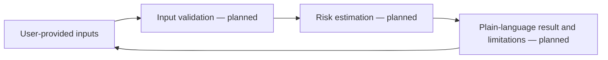

# HealthGuard — Health Risk Awareness Concept

<strong>A health-awareness project concept for turning basic user inputs into an understandable risk estimate.</strong>

## Intended experience

The project description proposes an interface that accepts basic health-related inputs and presents an estimated risk level to support early awareness. Any eventual experience should explain the inputs and limits behind the estimate and direct users to qualified care for medical decisions.

## Conceptual workflow

This diagram describes planned functionality. The repository includes a single-file static HTML concept preview with a hard-coded sample response. It has no user-input form, risk model/rules, backend, clinical evidence, or evaluation dataset. Opening `index.html` is enough to view the mock interaction; no build or install step exists.

## Limitations and next steps

To move beyond a concept, add a real interface and model/rule implementation, document the data source and validation approach, and explain clinical limitations. Do not use this preview to diagnose or treat a condition.

## Live concept preview

[Open the interactive prototype](https://kalyan870.github.io/HealthGuard-Health-Risk-Awareness-System/). This is a static concept preview using sample data, not a production backend. See the limitation notice in the app.

