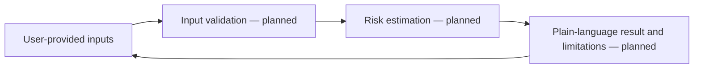

# HealthGuard — Health Risk Awareness Concept

<strong>A health-awareness project concept for turning basic user inputs into an understandable risk estimate.</strong>

## Intended experience

The project description proposes an interface that accepts basic health-related inputs and presents an estimated risk level to support early awareness. Any eventual experience should explain the inputs and limits behind the estimate and direct users to qualified care for medical decisions.

## Conceptual workflow

This diagram describes the intended concept, not an implemented architecture. The repository currently contains project copy and GitHub support files, but no runnable application source, installation instructions, or verified demo.

## Before presenting it as runnable

Add the interface and model/rule implementation, document the data source and validation approach, and explain clinical limitations. Do not use an awareness prototype to diagnose or treat a condition.

## Live concept preview

[Open the interactive prototype](https://kalyan870.github.io/HealthGuard-Health-Risk-Awareness-System/). This is a static concept preview using sample data, not a production backend. See the limitation notice in the app.

